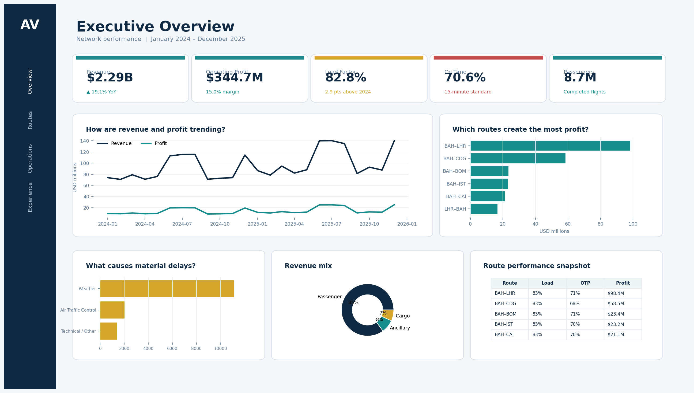
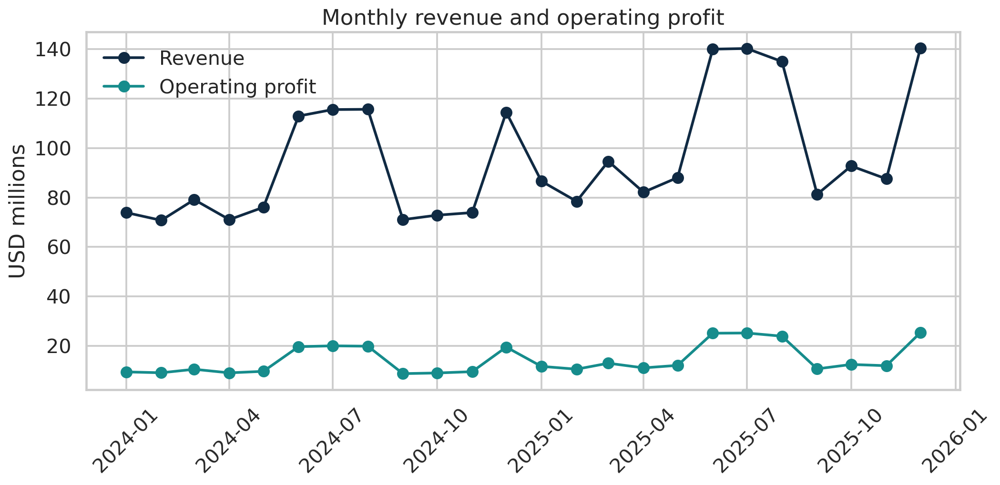
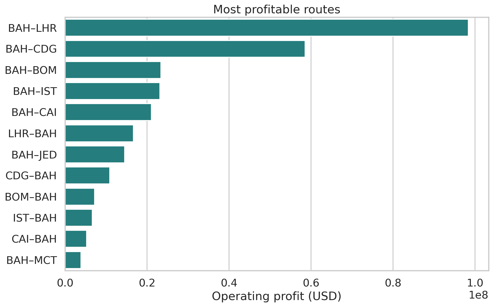
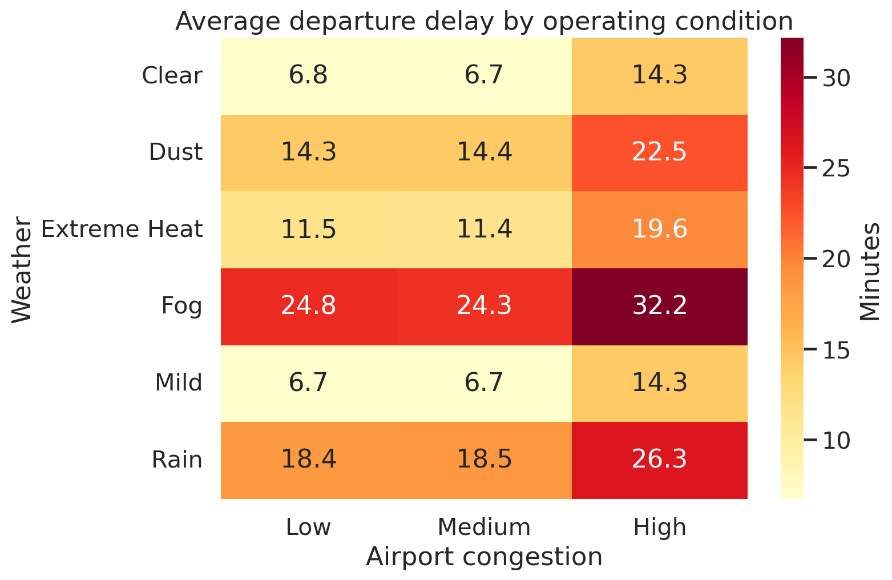
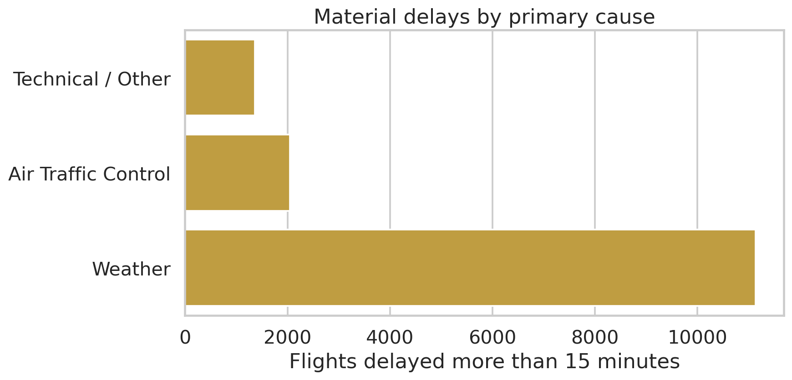
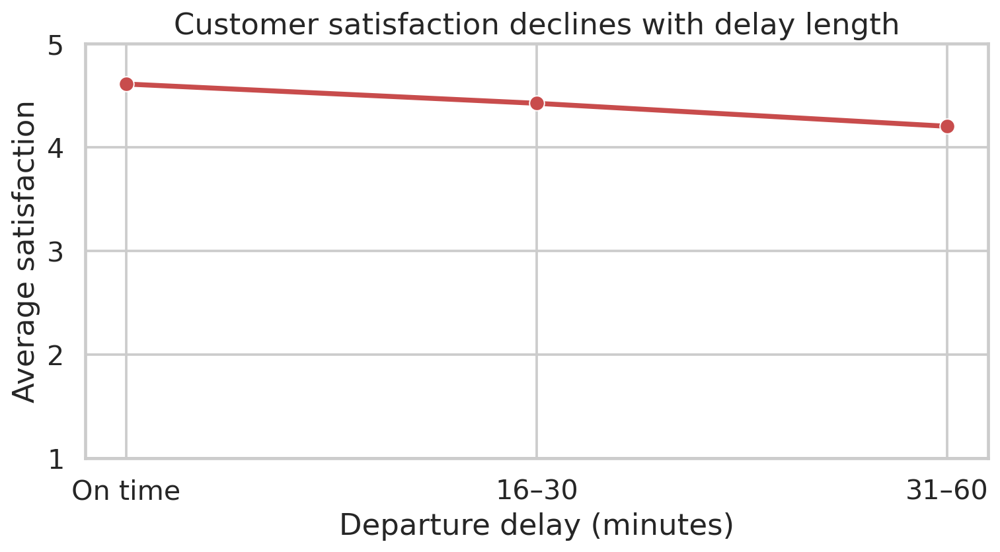
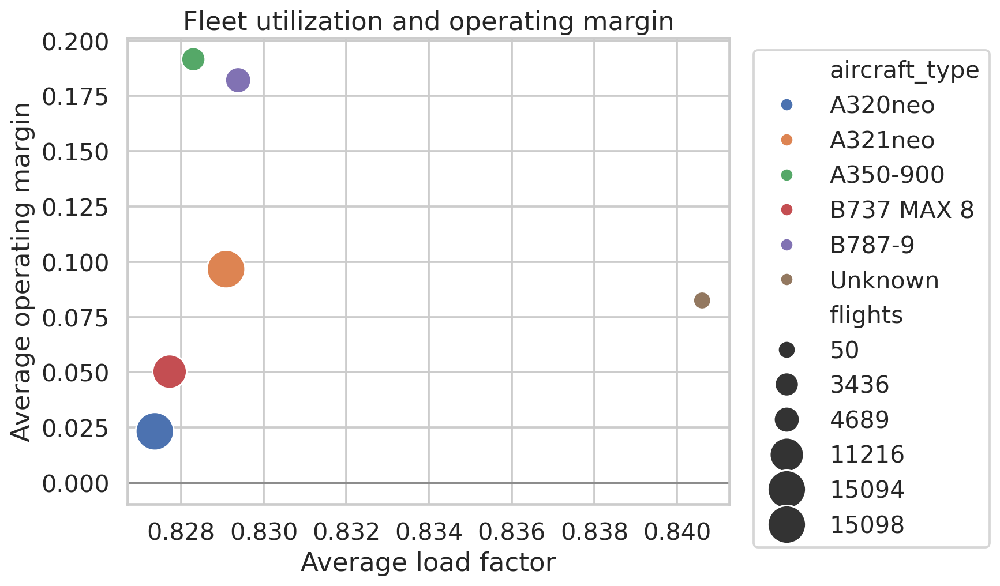

# Airline-Analytics

# AeroVista Airline Performance Analytics

An end-to-end analytics portfolio project built around **50,000  lights** operated across a GCC-centered regional and international network during 2024–2025.

The project demonstrates  data modeling, SQL data engineering, PostgreSQL analysis, Python EDA, star-schema design, DAX measure development, Power BI dashboard planning, and business communication. Every organization, flight, passenger outcome, and financial result is fictional.



## Business problem

AeroVista is a fictional Bahrain-based airline. Its leadership team wants to grow profit while improving punctuality and customer experience. The analysis addresses five questions:

1. Are revenue and operating profit growing sustainably?
2. Which routes and aircraft create the most economic value?
3. What conditions are responsible for flight delays and cancellations?
4. How do reliability problems affect customer satisfaction?
5. Where should management focus network, fleet, and operational investment?

## Dataset design

The raw dataset contains **50,220 rows**, including 220 deliberate duplicates. Cleaning produces **50,000 unique scheduled flights**. The generator models connected business relationships rather than independent random fields:

- Higher summer and December demand
- Year-on-year network growth in 2025
- Aircraft assignment based on route distance
- Load-factor and fare seasonality
- Weather, congestion, and peak-hour delay effects
- Passenger compensation after severe disruption
- Route-level revenue, cost, and operating margin
- Satisfaction decline as delays and mishandled baggage increase
- Controlled quality defects for a realistic cleaning exercise

## Project structure

```text
aerovista_airline_analytics/
├── data/
│   ├── raw/aerovista_flights_raw.csv
│   └── processed/flights_clean.csv
├── powerbi/
│   ├── data/
│   │   ├── fact_flights.csv
│   │   ├── dim_date.csv
│   │   ├── dim_route.csv
│   │   ├── dim_aircraft.csv
│   │   └── dim_airport.csv
│   ├── AeroVista_Executive_Theme.json
│   ├── DAX_Measures.md
│   ├── Power_Query_Setup.md
│   ├── Dashboard_Build_Guide.md
│   └── AeroVista_Dashboard_Preview.png
├── charts/
│   ├── 01_monthly_financials.png
│   ├── 02_route_profit.png
│   ├── 03_delay_heatmap.png
│   ├── 04_delay_causes.png
│   ├── 05_satisfaction_delay.png
│   └── 06_fleet_performance.png
├── python/
│   ├── eda_analysis.py
│   └── dashboard_preview.py
├── sql/
│   ├── 01_create_raw_table.sql
│   ├── 02_clean_transform.sql
│   ├── 03_create_star_schema.sql
│   └── 04_analysis_queries.sql
├── src/generate_data.py
├── data_dictionary.md
├── analysis_summary.json
├── requirements.txt
└── README.md
```

## Tools and skills demonstrated

- **PostgreSQL:** typed staging, validation, deduplication, CTEs, filtered aggregates, window functions, materialized dimensions, indexes, and Pareto analysis
- **Python:** pandas, NumPy, Matplotlib, and Seaborn
- **Power BI:** dimensional modeling, Power Query parameters, DAX, drill-through, bookmarks, tooltip design, conditional formatting, and report UX
- **GitHub:** reproducible project structure and business-facing documentation

## Reproduce the analysis

### Python setup

```bash
python -m venv .venv
source .venv/bin/activate        # Windows: .venv\Scripts\activate
pip install -r requirements.txt
python src/generate_data.py
python python/eda_analysis.py
python python/dashboard_preview.py
```

### PostgreSQL setup

```bash
psql -d your_database -f sql/01_create_raw_table.sql
```

From `psql` at the project root:

```sql
\copy aerovista.flights_raw FROM 'data/raw/aerovista_flights_raw.csv' CSV HEADER;
```

Then run:

```bash
psql -d your_database -f sql/02_clean_transform.sql
psql -d your_database -f sql/03_create_star_schema.sql
psql -d your_database -f sql/04_analysis_queries.sql
```

## SQL cleaning workflow

The SQL pipeline:

1. Loads all raw fields as text to prevent import failures.
2. Trims identifiers and standardizes airport codes.
3. Normalizes congestion labels and missing aircraft types.
4. Converts timestamps, integers, booleans, decimals, and currency fields.
5. Replaces the invalid `-1` delay sentinel with `NULL`.
6. Preserves missing satisfaction scores rather than treating them as zero.
7. Deduplicates flights with `ROW_NUMBER()`.
8. Validates passenger capacity, load factor, airport codes, and satisfaction ranges.
9. Creates analytical date, route, reliability, and margin fields.
10. Creates a star-schema layer and performance indexes.

## Executive findings

### Financial growth



- Completed-flight revenue increased from **$1.047 billion in 2024 to $1.247 billion in 2025**, representing **19.1% growth**.
- The network generated approximately **$344.7 million operating profit** and a **15.0% operating margin** across the two-year period.
- Seasonal peaks appear in summer and December, showing the importance of capacity planning before high-demand periods.

### Route economics



- **BAH–LHR** was the most profitable route, producing approximately **$98.4 million** in operating profit.
- **BAH–CDG** ranked second at approximately **$58.5 million**.
- The leading long-haul routes achieved margins above the network average, while volume alone did not guarantee profitability.

### Reliability pressure



- Network on-time performance was **70.7%**, based on departure within 15 minutes of schedule.
- **Fog combined with high airport congestion** generated the largest average delay.
- Weather was the leading cause of material delays, followed by air traffic control constraints.



### Customer experience



- Average satisfaction was **4.55 out of 5** among submitted ratings.
- On-time flights averaged approximately **4.61**, compared with **4.42** for delays of 16–30 minutes and **4.20** for delays of 31–60 minutes.
- The relationship supports proactive disruption communication and faster recovery as customer-experience priorities.

### Fleet performance



- The **B787-9** produced the most total operating profit, while the **A350-900** achieved the strongest average operating margin.
- Narrow-body aircraft supported network frequency but produced lower modeled margins, particularly the A320neo.
- Fleet decisions should consider route fit and profit per flight alongside load factor.

## Recommendations

1. **Protect high-value long-haul routes.** Prioritize schedule reliability, premium service, and aircraft availability on London and Paris services.
2. **Create a weather-and-congestion response plan.** Pre-position crews and aircraft, adjust block times, and improve passenger communication when fog or congestion risk is high.
3. **Improve network OTP to at least 75%.** Focus first on high-volume peak periods and routes with repeated air-traffic-control delays.
4. **Review narrow-body route economics.** Test schedule consolidation, aircraft swaps, and fare changes where load factor is acceptable but operating margin remains weak.
5. **Track disruption cost as a commercial KPI.** Combine compensation, lost revenue, customer satisfaction, and repeat-booking impact when prioritizing operational improvements.
6. **Use route-level targets.** A single network average can hide weak routes; assign load-factor, margin, and OTP targets by route family.

## Power BI dashboard

The supplied Power BI kit contains:

- Five Power BI-ready star-schema CSVs
- A professional JSON theme
- More than 25 DAX measures
- Power Query setup instructions
- Four report-page specifications plus route drill-through
- UX and interaction standards
- A high-resolution Executive Overview preview

Open [Power_Query_Setup.md](powerbi/Power_Query_Setup.md), import the theme, create the relationships, paste the measures from [DAX_Measures.md](powerbi/DAX_Measures.md), and follow [Dashboard_Build_Guide.md](powerbi/Dashboard_Build_Guide.md).

Microsoft requires Power BI Desktop to create or convert the final `.pbix`/`.pbip` file. The repository therefore includes honest, editable source assets rather than an unverified binary renamed as a Power BI file.

## Limitations

- Financial results use modeled flight-level cost allocations and exclude financing and tax.
- Satisfaction is voluntary and may not represent every passenger.
- Delay cause is simplified to one primary category per flight.
- Route performance is descriptive and does not replace network-optimization modeling.

## Possible extensions

- Forecast route demand with time-series models.
- Predict delay risk before departure.
- Add crew, airport, and aircraft-tail dimensions.
- Create a route profitability scenario tool in Power BI.
- Publish the dashboard to Power BI Service with mobile layouts and row-level security.
